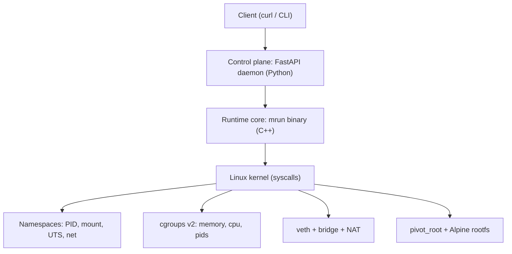
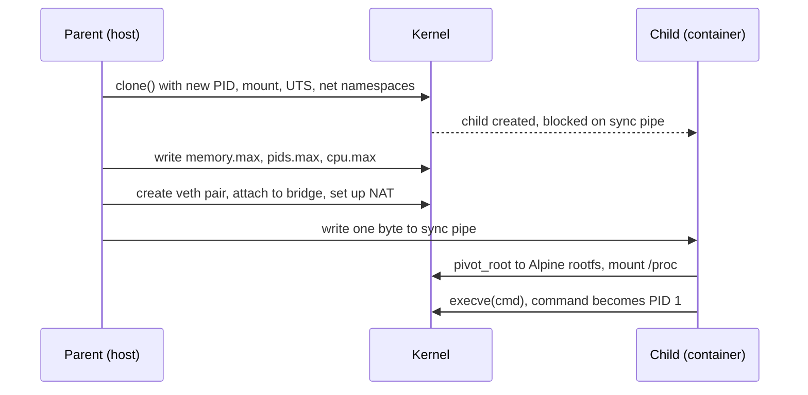

# Mini Container Runtime (a tiny Docker from scratch)

![[Pasted image 20261117150635.png]]

## One-liner

Build a simple container runtime in C++ directly on top of Linux syscalls, without using Docker itself, then put a FastAPI daemon on top to control it.

## Core idea

A container is **not a VM**. It is a normal process on the host kernel, with the kernel lying to it in two ways:

- **Namespaces** control what the process can *see*: its own PID 1, its own filesystem, hostname, and network. Hardware analogy: the MMU gives each process a virtual address space. Namespaces give each process a virtual view of the OS.
- **cgroups** control how much the process can *use*: RAM, CPU, number of processes. Hardware analogy: a power/thermal budget enforced by an arbiter. Exceed it and you get throttled or killed.

This is what `docker run` actually does under the hood.

## Why it is a strong CV project

1. Proves understanding below the abstraction. Anyone can write a Dockerfile. Few can explain how the kernel isolates a process.
2. Covers Backend + DevOps + Cloud in one project (API server, infrastructure, and the primitives every cloud runs containers on).
3. Turns OSTEP theory (processes, virtualization, isolation, synchronization) into running code.
4. Great interview material: "How does Docker isolate?" -> "I built it, here is the code."

## How it maps to what I study

| Topic | Where it shows up |
|---|---|
| C/C++ | The runtime: `clone()`, `unshare()`, `execve()`, `mount()` |
| OSTEP | Processes, virtualization, memory limits, sync between parent and child |
| Linux | Namespaces (PID, mount, UTS, net), cgroups v2, `pivot_root` |
| Networks | `veth` pairs + bridge + NAT (iptables) so the container can reach the internet |
| Docker | Understand what `docker run` really does |
| FastAPI | REST API over the runtime |
| Git/GitHub | GitHub Actions: build, tests, release |

Java is skipped on purpose: no logical place for it here.

## Architecture



- **Control plane (FastAPI):** receives HTTP requests, stores container state, spawns the runtime as a subprocess. No isolation logic here.
- **Runtime core (C++):** CLI like `mrun run --mem 64M --rootfs ./alpine /bin/sh`. Does the isolation with syscalls. Usable without the API.
- **Kernel:** does the actual isolation. I only ask it to.

Key design decision: **the runtime is a separate binary from the daemon.** Same split as real Docker (`dockerd` on top of `runc`). It lets me test the runtime alone.

## What happens on `run`



The child must **wait** until the parent finishes cgroups and networking before `execve`. Solved with a **sync pipe**: child blocks on `read()`, parent writes a byte when ready. First real race condition I will meet, and a good link to OSTEP's synchronization chapters.

## HLD

### API

| Endpoint | Purpose |
|---|---|
| `POST /containers` | Create and start a container (image, cmd, mem, cpu) |
| `GET /containers` | List all containers and their state |
| `GET /containers/{id}/stats` | Read `memory.current` and `cpu.stat` from the cgroup |
| `POST /containers/{id}/stop` | `SIGTERM`, then `SIGKILL` after a timeout |
| `DELETE /containers/{id}` | Clean up cgroup, veth, mounts |

### State

No database at first. Each container gets `/var/lib/mrun/<id>/state.json` (PID, status, limits, IP). The daemon reads it, so it survives restarts.

### Lifecycle

`created -> running -> stopped -> removed`

### Repo layout

```
mini-container/
├── runtime/        # C++: namespaces.cpp, cgroups.cpp, network.cpp, main.cpp
├── daemon/         # FastAPI: routes, state store, runtime wrapper
├── tests/          # fork bomb, memory hog, ping test
├── docs/           # architecture diagrams, security notes
└── .github/workflows/
```

## Milestones

1. **Basic isolation:** `mrun run /rootfs /bin/sh` with PID + mount + UTS namespaces and `pivot_root` on an Alpine rootfs. (~150 lines of C++)
2. **Resource limits:** cgroups v2 for RAM, CPU, and process count. Test with a fork bomb inside the container and watch it get stopped.
3. **Networking:** net namespace + veth + bridge + NAT. Container can `ping 8.8.8.8`. Add port forwarding.
4. **FastAPI control plane:** start, stop, list containers, and read stats from cgroups.
5. **Image layers (optional):** overlayfs for Docker-like layers.

Start with milestone 1 only.

## Hard parts to expect

- **Step ordering:** `pivot_root` before network setup means I cannot run `ip` inside the new rootfs.
- **Cleanup:** a crashed container can leave veth and cgroups behind. Must handle crashes.
- **cgroups v2:** docs are unclear at times, and controllers must be enabled manually in `cgroup.subtree_control`.
- **Root privileges:** everything needs `sudo`. Work in a VM or WSL2, not on the main machine.

## What makes the CV impact real

- Strong README: architecture diagram and why each syscall is used.
- **Security note:** state clearly what is isolated and what is not (no seccomp, no user namespaces in v1). Knowing the limits of my own work looks stronger than claiming "I built a new Docker".
- Benchmark: startup time vs Docker.
- Short demo GIF/video: run a container, then watch it get killed by its memory limit.
- Optional link: let the stats collector from the system monitor project read from cgroups in milestone 4, so the two projects connect.

## Related

- [[OSTEP 12 Week Plan]]
- [[Linux-MOC]]
- [[Docker]]
- [[Networks for Backend and DevOps]]
